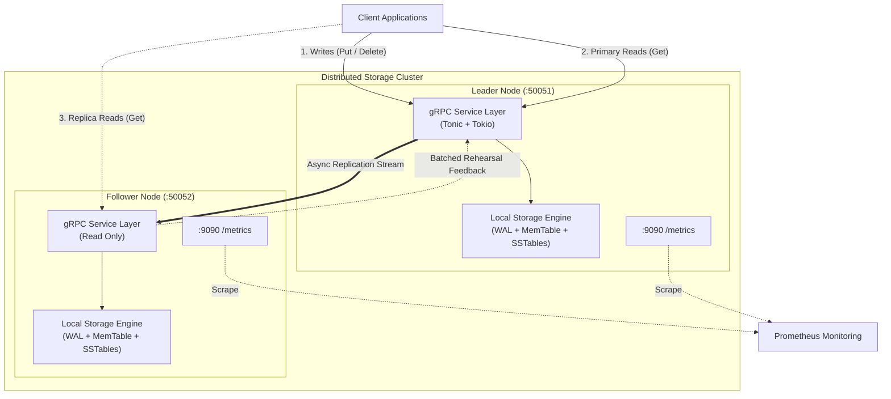
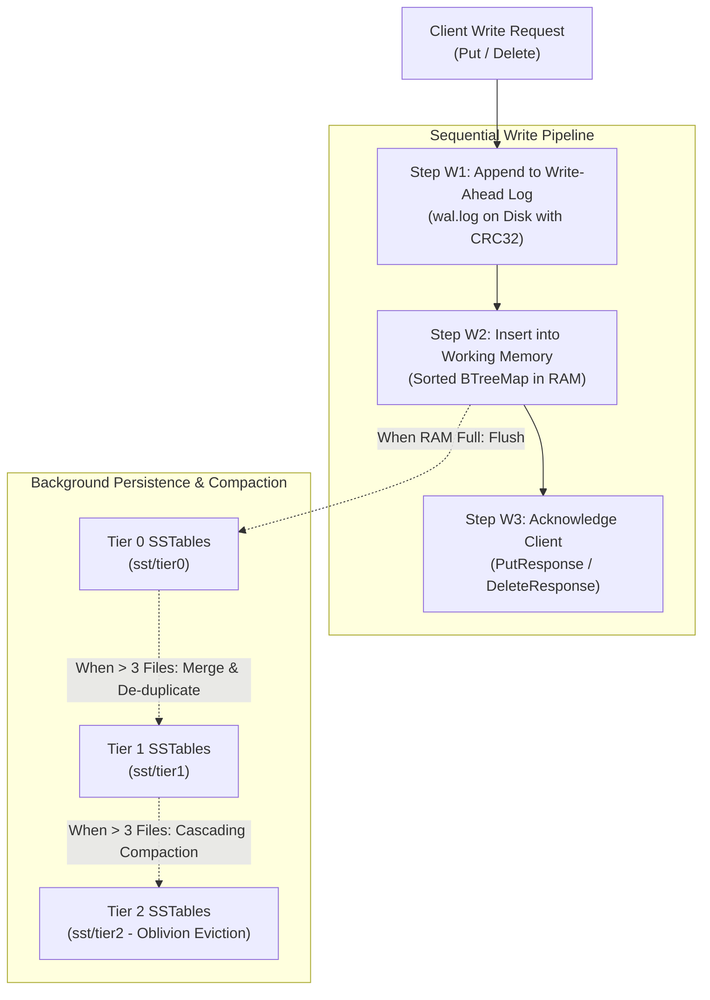
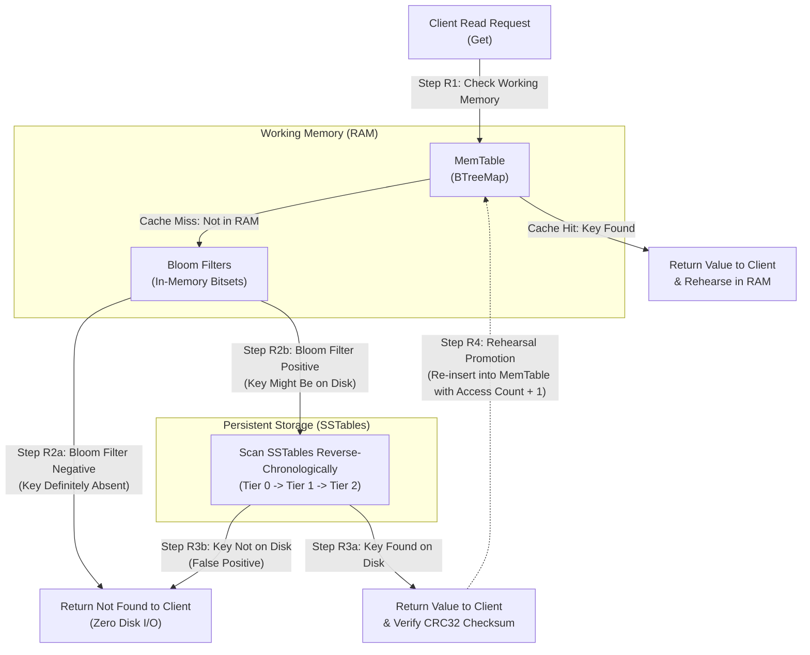
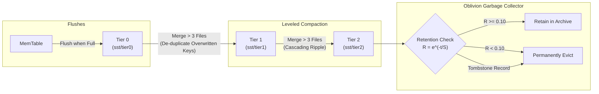

# Architecture Guide: Ebbinghaus Storage Engine

Hello, thanks for coming to read more about my project! I really enjoyed the process of designing and implementing it, so I hope that this breakdown helps you better understand it :)

I built this project to explore what happens when you take the classical Log-Structured Merge-tree (LSM-tree) architecture used in production databases like RocksDB, and redesign its eviction and compaction policies around exponential time-decay and access frequency.

---

## 1. Motivation and Conceptual Background

In standard storage engines, cache eviction and data cleanup typically follow simple heuristics like Least Recently Used (LRU) or Least Frequently Used (LFU). While those policies work well for uniform workloads, they fall short in modern applications like AI context storage and agentic scratchpads. In those systems, hundreds of intermediate facts are written once and never read again, while a handful of critical instructions are repeatedly queried.

I drew inspiration from Hermann Ebbinghaus's empirical model of human memory decay. In his model, the retention strength of information decreases exponentially over time according to:

R = e^(-t / S)

Where:
* R is retention strength (scaled between 0.0 and 1.0).
* t is the time elapsed since the record was last accessed.
* S is the stability of the record, which increases with every retrieval event (rehearsal).

Instead of relying on TTLs (Time-To-Live) or LRU queues, this engine integrates that exact mathematical curve directly into its storage hierarchy. Every time a record is read, its stability increases. When data is pushed down through the storage tiers, records whose retention score drops below a configurable oblivion threshold are permanently evicted during compaction.

---

## 2. Technology Primer

If you are new to distributed systems or the Rust ecosystem (like I was before this project), here is a quick overview of key concepts and libraries I used!

### Log-Structured Merge-Tree (LSM-Tree)
An LSM-tree is a storage architecture optimized for high write throughput. Instead of updating records in place on disk (which requires slow random disk writes), an LSM-tree buffers incoming writes in a fast in-memory structure called a MemTable. When the MemTable fills up, it is flushed to disk as an immutable sorted file called an SSTable.

### Write-Ahead Log (WAL)
Because in-memory data disappears if a machine crashes or loses power, every write operation must be appended to an on-disk log file before the write is acknowledged. During startup, if the system was interrupted uncleanly, it replays the WAL to reconstruct its in-memory state.

### SSTables (Sorted String Tables)
An SSTable is an on-disk, immutable file containing key-value pairs sorted alphabetically by key. Because the keys are strictly ordered, searching within an SSTable can be done very efficiently without scanning the entire file randomly.

### Bloom Filters
When searching for a key across many SSTables on disk, reading every file to check if a key exists would create severe disk I/O bottlenecks. A Bloom filter is a space-efficient, probabilistic data structure that can test whether an element is a member of a set. It can return false positives (saying a key might exist when it does not), but it never returns false negatives. If the Bloom filter says a key is not present, the engine skips opening the file entirely.

### Tokio
Tokio is an asynchronous runtime for the Rust programming language. It provides non-blocking I/O primitives, task scheduling, timers, and synchronization tools. It allows us to handle thousands of concurrent client connections across worker threads without dedicating an entire OS thread to each client.

### Protocol Buffers and gRPC (Tonic)
Protocol Buffers (Protobuf) is a language/platform-neutral mechanism for serializing data into compact binary payloads. gRPC is a high-performance RPC (Remote Procedure Call) framework built on top of HTTP/2. Tonic is the native Rust implementation of gRPC that I used to expose network services and coordinate node replication.

### Prometheus
Prometheus is a monitoring and alerting toolkit. It collects real-time metrics over HTTP using a pull model to record time-based data for us such as request latency histograms, throughput counters, and eviction rates.

---

## 3. High-Level System Architecture

To make the architecture as clear and digestible, I've divided the system into two perspectives: the distributed cluster topology across machines, and the internal storage engine dataflow inside an individual node.

### 3.1 Distributed Cluster Topology

This diagram shows how client requests, background node replication, and telemetry metrics flow between machines across the network:



### 3.2 Node Storage Engine: The Write Path and Persistence Pipeline

Writing data follows a strict sequence to guarantee durability while maximizing ingestion throughput:

1. **Step W1 (Append to Log)**: The mutation (Put or Delete) is written sequentially to the Write-Ahead Log (`wal.log`) on disk with a CRC32 checksum.
2. **Step W2 (Insert into Memory)**: Once persisted to the WAL, the record is inserted into the in-memory MemTable (BTreeMap) so it is immediately visible to reads.
3. **Step W3 (Acknowledge)**: The gRPC call returns success to the client without waiting for disk SSTable flushes.
4. **Background Persistence**: When the MemTable exceeds its capacity threshold, a background task flushes it as an immutable SSTable into `sst/tier0`. Subsequent background compaction merges files across tiers down to `tier2`.



### 3.3 Node Storage Engine: The Read Path and Rehearsal Promotion

Reading data prioritizes fast in-memory paths and uses Bloom filters to eliminate unnecessary disk seeks:

1. **Step R1 (Check Working Memory)**: The engine searches the in-memory MemTable first. If found (Cache Hit), it returns the value immediately and rehearses the record (increments access count and updates timestamp).
2. **Step R2 (Check Bloom Filters)**: On a MemTable miss, the engine checks the in-memory Bloom filters for persisted SSTables without reading file contents from disk.
   - **Step R2a (Negative)**: If the Bloom filter returns negative, the key is guaranteed not to exist in that SSTable. The engine avoids touching the disk and returns Not Found.
   - **Step R2b (Positive)**: If the Bloom filter returns positive, the key might exist on disk.
3. **Step R3 (Scan SSTables on Disk)**: The engine opens the SSTable and scans its binary records in reverse chronological order across tiers (`tier0` -> `tier1` -> `tier2`).
   - **Step R3a (Key Found)**: The engine verifies the payload CRC32 checksum and returns the value to the client.
   - **Step R3b (False Positive)**: If the file does not contain the key, it returns Not Found.
4. **Step R4 (Rehearsal Promotion)**: When a key is successfully retrieved from disk, it is promoted back into the in-memory MemTable with an incremented access count (`access_count + 1`). This brings cold data back into fast RAM and increases its stability factor against future decay.



---

## 4. Deep Dive: The Core Subsystems

### 4.1 Write-Ahead Log (WAL) and Binary Protocol

Durability is guaranteed by appending every mutation to `wal.log` before updating in-memory state. I designed a custom binary format aligned to 8-byte boundaries to maximize read and write performance:

```
+-----------------------------------------------------------------------+
| Byte Offset | Field Name    | Type   | Description                    |
+-------------+---------------+--------+--------------------------------+
| 00 - 03     | checksum      | u32    | CRC32 of key + value payload   |
| 04 - 07     | key_length    | u32    | Length of key in bytes         |
| 08 - 11     | value_length  | u32    | Length of value in bytes       |
| 12 - 15     | access_count  | u32    | Number of rehearsals recorded  |
| 16 - 23     | timestamp     | u64    | Millisecond Unix timestamp     |
| 24          | record_type   | u8     | 0 = Put, 1 = Delete            |
| 25 - 31     | padding       | [u8;7] | Zero-padding for 8-byte align  |
| 32 - ...    | payload       | bytes  | Key bytes followed by value    |
+-----------------------------------------------------------------------+
```

Key guarantees of this format:
1. **Corruption Detection**: The 32-bit CRC32 checksum covers the entire payload. If disk corruption or a partial write occurs, the crash recovery parser flags the entry and halts or recovers cleanly.
2. **Deletions via Tombstones**: Deleting a key does not erase data immediately. Instead, it logs a record with `record_type = 1` (a tombstone). This tombstone masks older versions across all storage tiers (because it will always be the most recent record for this key) until compaction permanently removes it.
3. **Crash Recovery**: During initialization, `recover_from_wal()` scans `wal.log` sequentially, verifies every checksum, and populates the in-memory MemTable so zero acknowledged writes are lost.

### 4.2 In-Memory MemTable and Concurrency

The MemTable is backed by Rust's standard `BTreeMap<Vec<u8>, (Vec<u8>, RecordType, u64, u32)>`. 

I opted for a `BTreeMap` over a hash table because it keeps all keys lexicographically sorted in memory at all times. When the MemTable exceeds its configured byte capacity, it can be written to disk sequentially as an SSTable with zero extra sorting overhead.

For concurrency, I wrapped the MemTable in `Arc<tokio::sync::Mutex<MemTable>>`. While read-heavy databases frequently use an `RwLock` to allow multiple concurrent readers, this engine deliberately uses a standard `Mutex`. Because every single read request evaluates the forgetting curve and updates the record's access count and timestamp (rehearsal), every read is fundamentally also a state modification, so an `RwLock` is unnecessary additional sychronization overhead.

### 4.3 Persistence and Bloom Filters

When the MemTable reaches capacity, it is flushed to disk as an immutable SSTable in `sst/tier0/{timestamp}.sst`.

Each SSTable is accompanied by an in-memory and on-disk Bloom filter stored in `sst/tier0/{timestamp}.bloom`. To keep the binary lean and avoid unnecessary external dependencies, I implemented double-hashing using the Kirsch-Mitzenmacher optimization with two seeded CRC32 hashes:

$$g_i(x) = h_1(x) + i \cdot h_2(x) \pmod m$$

This technique generates multiple independent hash positions across the bit array with minimal computation. When a query misses in the MemTable:
1. The engine checks the Bloom filter in RAM for the target SSTable.
2. If the filter returns false, the key is mathematically proven not to exist in that file, and the engine skips all disk reads for that SSTable.
3. If the filter returns true, the engine opens the SSTable file and reads the headers.

### 4.4 Persistent Search and Rehearsal Promotion

When a key is missing from working memory, `search_sstables()` executes a reverse-chronological search across the tiered directories: `sst/tier0`, then `sst/tier1`, then `sst/tier2`.

When an active record is found on disk:
1. The engine validates its CRC32 checksum to guarantee payload integrity.
2. It extracts the historical access count.
3. **Promotion Step**: The engine re-inserts the record back into the MemTable with an incremented access count (`access_count + 1`) and the current timestamp.

This promotion brings frequently queried data back into RAM, increasing its stability factor so that its retention decay slows down significantly in future cycles.

### 4.5 Leveled Compaction and Time-Decay Eviction

As new SSTables flush to disk, files accumulate in `sst/tier0`. Left unchecked, this would degrade read latency and exhaust disk space.

I implemented a Leveled Compaction subsystem (`compact_tier`):
1. **Trigger Condition**: When `sst/tier0` accumulates more than 3 files, compaction triggers automatically.
2. **K-Way Merge**: An internal `Scanner` struct wraps each SSTable file in a `BufReader`. The compaction loop iterates across all active scanners, compares their current keys lexicographically, and identifies the smallest key.
3. **De-duplication**: If multiple SSTables contain the same key, the newest record (based on timestamp) is chosen, and all other scanners holding older versions of that key are advanced. Older overwritten data is discarded immediately.
4. **Time-Decay Eviction at the Lowest Tier**:
   - In higher tiers (`tier0` and `tier1`), tombstones and low-retention records are preserved so they do not prematurely unmask older data in deeper tiers.
   - When compaction runs on the lowest tier (`tier2`), the engine acts as an eviction garbage collector.
   - Any tombstone record is dropped permanently.
   - Any record whose retention strength has fallen below the threshold (R < 0.10) is discarded and omitted from the newly written compacted file.
5. **Cascading Ripple**: Once `tier0` merges into `tier1`, the engine checks if `tier1` now exceeds its capacity. If so, it ripples compaction down into `tier2`, keeping the entire storage hierarchy balanced.



### 4.6 Asynchronous gRPC Service Layer

The engine exposes its storage operations over gRPC using Tonic and Protocol Buffers. The service contract defined in `proto/ebbinghaus.proto` includes:

* `rpc Get (GetRequest) returns (GetResponse)`: Retrieves values and triggers retention rehearsal.
* `rpc Put (PutRequest) returns (PutResponse)`: Appends to WAL and inserts into working memory.
* `rpc Delete (DeleteRequest) returns (DeleteResponse)`: Writes a tombstone to mark key deletion.
* `rpc Replicate (ReplicateRequest) returns (ReplicateResponse)`: Streams mutation batches between nodes.
* `rpc SyncRehearsal (RehearsalBatch) returns (RehearsalAck)`: Batches aggregated read counts from followers back to the leader.

Clients interact with the engine using high-performance HTTP/2 multiplexing, enabling concurrent access from multiple processes or microservices.

### 4.7 Leader-Follower Replication and Node Synchronization

To support distributed scaling, the engine implements a Leader-Follower architecture:

1. **Role Separation**: A node runs as either a `Leader` or a `Follower`.
2. **Replication Broadcast**: When a client writes to the Leader:
   - The Leader commits the mutation to its local WAL and MemTable.
   - The Leader acknowledges the client immediately.
   - The Leader packages the operation into a `ReplicationRecord` and asynchronously broadcasts it to all registered follower endpoints via the `Replicate` gRPC endpoint inside a spawned Tokio task.
3. **Follower Ingestion**: Follower nodes receive replication batches and apply them directly to their local WAL and MemTable.
4. **Read Scaling and Write Protection**:
   - Follower nodes reject direct `Put` and `Delete` requests with a `FailedPrecondition` gRPC status error, preventing split-brain state mutations.
   - Follower nodes freely serve `Get` requests locally, allowing horizontal scaling of read throughput across the cluster.
5. **Asynchronous Rehearsal Telemetry (Eliminating Decay Skew)**:
   - Offloading reads to follower nodes keeps tail latency ultra-low (sub-1 millisecond). However, this creates a potential distributed consistency challenge: if a key is queried heavily on a follower but never directly on the leader, the leader's copy of the key would normally continue to decay.
   - Left unaddressed, a leader-side Tier 2 compaction might prematurely evict a record that clients are actively querying on replicas.
   - To solve this without adding network round-trip overhead to client reads, followers maintain an in-memory frequency buffer of key accesses.
   - Periodically (every 500 milliseconds or 1,000 reads), the follower flushes this buffer to the leader via a compact `SyncRehearsal` gRPC call.
   - The leader merges these access counts into its local engine, updating the record's stability factor S and refreshing its decay timestamp.
   - This decoupled approach works because exponential memory decay operates on the order of seconds or minutes. A 500-millisecond buffering window introduces zero noticeable decay skew, completely protects active follower data from premature eviction, and reduces network overhead by several orders of magnitude compared to synchronous read coordination.

### 4.8 Prometheus Telemetry and Observability

The engine exposes an HTTP endpoint on port 9090 (`/metrics`) formatted for Prometheus scraping. Key metrics include:

* `ebbinghaus_requests_total{op, status}`: Counter tracking request volume across Get, Put, Delete, and Replicate.
* `ebbinghaus_request_duration_seconds{op}`: Histogram tracking execution latency with granular buckets from 100 microseconds to 10 milliseconds, providing direct visibility into p50, p95, and p99 tail latencies.
* `ebbinghaus_evictions_total`: Counter tracking the total number of records permanently discarded during lowest-tier compaction due to retention decay.
* `ebbinghaus_memtable_bytes`: Gauge tracking active working memory consumption.
* `ebbinghaus_average_retention_score`: Gauge monitoring the aggregate decay state of persisted records.

---

## 5. Performance and Latency Goals

I designed this engine to hit demanding operational targets:

* **Throughput**: Sustained 10,000+ requests per second under concurrent multi-threaded load.
* **Read Tail Latency**: Sub-1 millisecond p99 latency for hot keys residing in working memory or covered by Bloom filters.
* **Low Write Amplification**: Sequential WAL appending combined with geometric leveled compaction minimizes random disk heads movement.
* **Predictable Garbage Collection**: Time-decay eviction occurs incrementally during background compaction passes rather than during synchronous client write paths.

---

## 6. Directory Layout

```
ebbinghaus-store/
├── Cargo.toml               # Package dependencies and build configuration
├── build.rs                 # Protobuf compilation script via tonic-build
├── README.md                # Landing page, quickstart, and project summary
├── ARCHITECTURE.md          # Complete technical architecture specification
├── proto/
│   └── ebbinghaus.proto     # gRPC service and protobuf message definitions
├── src/
│   ├── main.rs              # Application entrypoint, CLI runner, and test suite
│   ├── wal.rs               # Binary WAL format, append logging, and crash recovery
│   ├── memtable.rs          # MemTable, decay math, search path, and compaction
│   ├── bloom.rs             # Bloom filter double-hashing and disk serialization
│   └── server.rs            # Asynchronous gRPC service and leader-follower replication
└── sst/                     # Data storage directory (ignored by git)
    ├── tier0/               # Fresh SSTables flushed from MemTable
    ├── tier1/               # Intermediate consolidation tier
    └── tier2/               # Long-term archive and time-decay eviction tier
```

---

## 7. Summary

By combining the structural efficiency of an LSM-tree with mathematical retention scoring, this engine delivers high write throughput, predictable memory footprint, and low tail latencies. If you have questions or want to dive deeper into any specific module, feel free to explore the corresponding files linked above!

